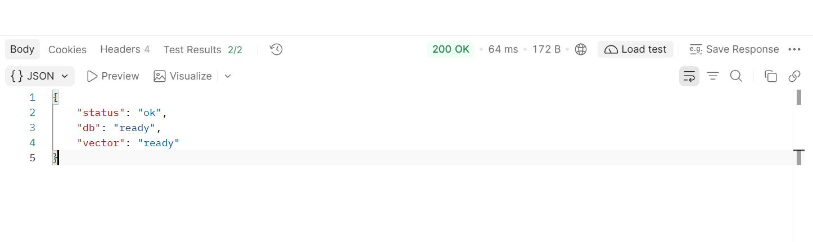
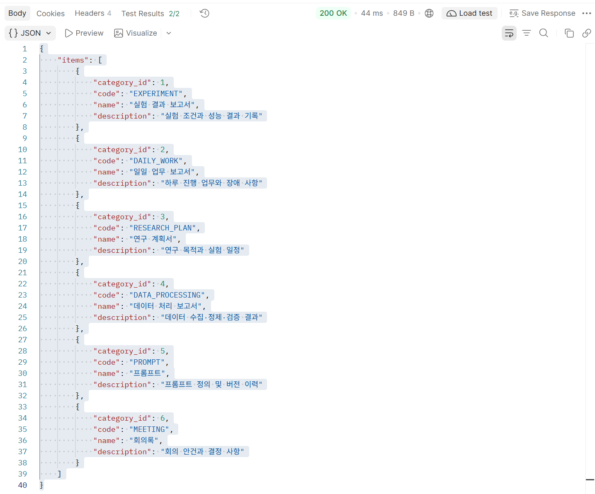
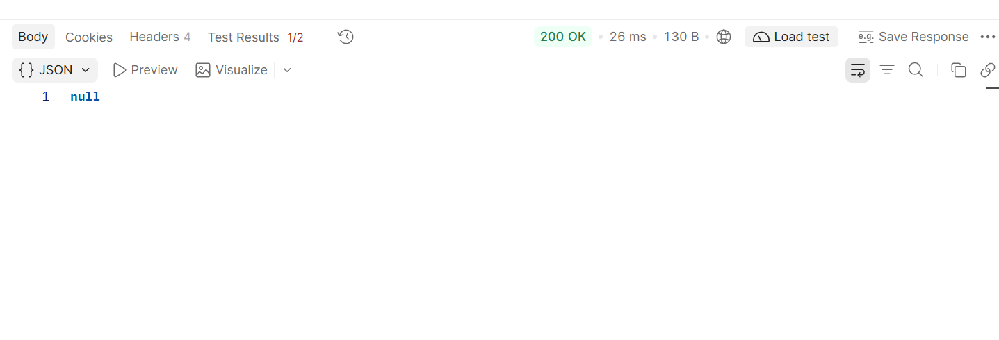

# 261118 B08 실행 결과 보고서

* **소속:** Cyberdyne Systems
* **작성자:** John Connor
* **보고서 번호:** FRI Rpt API 00, 01, 03번 진행 과정 보고서

제출 해야 하는 시간이 지나 완성하지 못 했지만 진행한 만큼 완성된 결과물과 진행 중인 결과물을 보고 하는 보고서 입니다.

완성된 결과물이 아니라 성공 사례와 실패 사례라고 단정 지을 수 없지만 타 팀에서 이어 연구한다면
더 흥미로운 결과가 나올 것으로 보입니다.

---

## API 00 번 실행 결과 (health 확인 [실행 값] : (http://127.0.0.1:8000/health)) 

```json
{
    "status": "ok",
    "db": "ready",
    "vector": "ready"
}
```
## API 01번 실행 결과 (카테고리 6건 확인 [실행 값] : (http://127.0.0.1:8000/api/v1/categories))

```json
{
    "items": [
        {
            "category_id": 1,
            "code": "EXPERIMENT",
            "name": "실험 결과 보고서",
            "description": "실험 조건과 성능 결과 기록"
        },
        {
            "category_id": 2,
            "code": "DAILY_WORK",
            "name": "일일 업무 보고서",
            "description": "하루 진행 업무와 장애 사항"
        },
        {
            "category_id": 3,
            "code": "RESEARCH_PLAN",
            "name": "연구 계획서",
            "description": "연구 목적과 실험 일정"
        },
        {
            "category_id": 4,
            "code": "DATA_PROCESSING",
            "name": "데이터 처리 보고서",
            "description": "데이터 수집·정제·검증 결과"
        },
        {
            "category_id": 5,
            "code": "PROMPT",
            "name": "프롬프트",
            "description": "프롬프트 정의 및 버전 이력"
        },
        {
            "category_id": 6,
            "code": "MEETING",
            "name": "회의록",
            "description": "회의 안건과 결정 사항"
        }
    ]
}
```

## API 03 번 실행 결과 (시드 보고서 ID 조회 확인 [실행 값] : (http://127.0.0.1:8000/{{base_url}}/api/v1/reports/{{seed_report_id}}))  

```json
null
```

## 하고 싶은 말
시간과 기술력이 모두 부족해 완성하지 못한 결과물 입니다.

추후 타 팀과 혹은 이어 연구해 보완 한다면 더욱 보완해 발표해 드릴것을 약속 드리겠습니다.